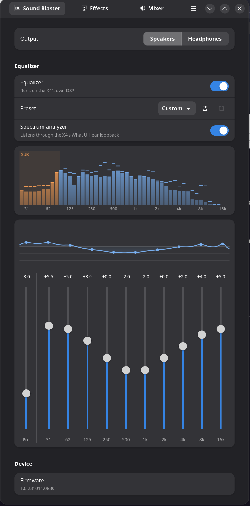
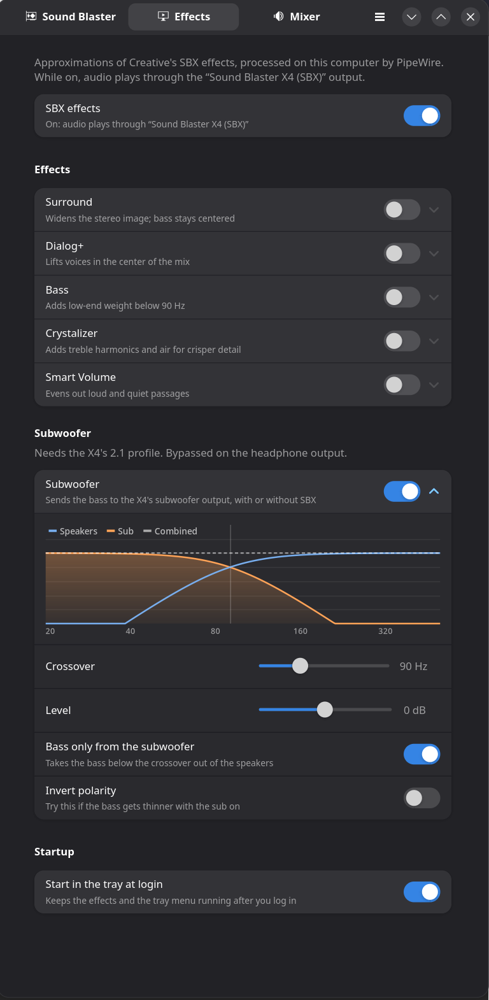
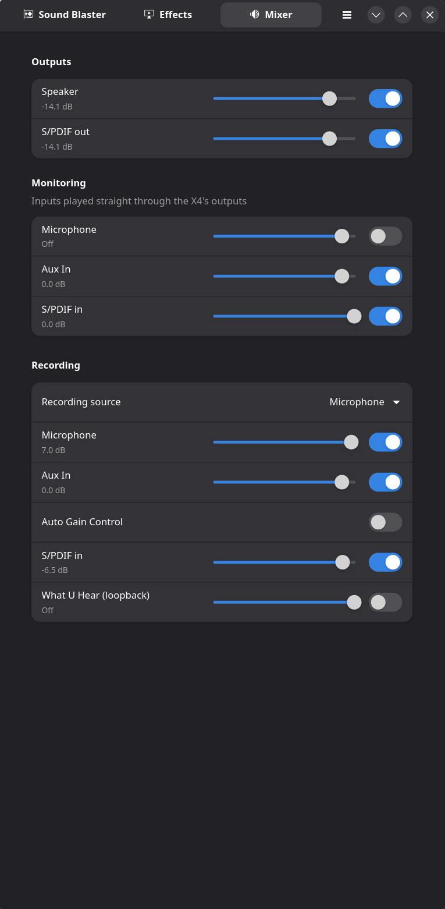

# sbx4-control

GTK control panel for the Creative Sound Blaster X4 (USB `041e:3278`) on Linux.

<table>
  <tr>
    <td></td>
    <td></td>
    <td></td>
  </tr>
  <tr>
    <td align="center">Sound Blaster: EQ and analyzer</td>
    <td align="center">Effects and subwoofer</td>
    <td align="center">Mixer</td>
  </tr>
</table>

- **Sound Blaster** page: speaker/headphone output, the X4's hardware 10-band
  EQ and pre-amp, built-in presets, and your own presets
  (`~/.config/sbx4-control/presets.json`).
- **EQ curve** (Sound Blaster page): the EQ's overall response, drawn above the
  sliders and updated as you drag them.
- **Spectrum analyzer** (Sound Blaster page): 48 log-spaced bands, 25 Hz–20 kHz,
  from the X4's hardware "What U Hear" loopback read directly through ALSA.
  That keeps it out of PipeWire (so GNOME shows no microphone indicator) and
  shows the output after the X4's own EQ. While it's on screen, the X4's
  recording source is switched to What U Hear; it's restored when the analyzer
  is hidden or the app quits.
- **Effects** page: approximations of Creative's SBX effects (Surround,
  Dialog+, Bass, Crystalizer, Smart Volume). The X4 doesn't do these in
  hardware; on Windows, Creative's driver runs them on the PC. Here they run
  as a PipeWire filter-chain (`pipewire -c ~/.config/sbx4-control/sbx-filter.conf`,
  started by the app) that adds a "Sound Blaster X4 (SBX)" output and makes it
  the default. Turning SBX off stops the filter and makes the X4 the default
  again. Smart Volume needs `lsp-plugins-lv2`.
- **Subwoofer** (Effects page): with the X4 on its 2.1 profile, sends the bass
  below an adjustable crossover (40–200 Hz, 4th-order Linkwitz-Riley) to the
  subwoofer output, with level, polarity, and an option to keep the bass in the
  speakers too. It runs in the same PipeWire filter, so audio has to play
  through “Sound Blaster X4 (SBX)”; with SBX switched off the filter keeps
  running for the sub with the effects bypassed. Bypassed on the headphone
  output.
  A graph shows the speaker and sub curves and their sum as you adjust it, and
  the analyzer shades the sub's range.
- **Appearance**: light, dark or follow the system, from the window menu.
- **Mixer** page: the X4's hardware volumes, input monitoring and recording
  source, through ALSA.
- **Tray icon**: output, EQ and preset, SBX and individual effects. Closing the
  window keeps the app in the tray; "Start in the tray at login" (Effects page)
  adds a login item that runs `sbx4-control --background`.

The mic effects (CrystalVoice) aren't available: like SBX, Windows does them
in the driver.

Needs PipeWire 1.0+ for effects (Ubuntu 24.04, Debian 12+). The tray needs a
StatusNotifierItem host: Ubuntu's built-in AppIndicator extension, or
`gnome-shell-extension-appindicator` on Debian.

## Install

Download a package from the
[latest release](https://github.com/scott-hiemstra/SBX4-Control/releases/latest):

| Distro                       | Package                          | Install                                   |
|------------------------------|----------------------------------|-------------------------------------------|
| Ubuntu 22.04+, Debian 12+    | `sbx4-control_*_amd64.deb`       | `sudo apt install ./sbx4-control_*.deb`   |
| Fedora 43+                   | `sbx4-control-*.x86_64.rpm`      | `sudo dnf install ./sbx4-control-*.rpm`   |
| Arch Linux                   | `sbx4-control-*.pkg.tar.zst`     | `sudo pacman -U sbx4-control-*.pkg.tar.zst` |

Each package adds a udev rule that gives the logged-in user access to the X4's
control port. If the X4 was plugged in before installing, unplug and replug it
once.

To build the packages yourself (needs Docker): `./build-deb.sh` or
`./build-rpm.sh`; they land in `target/`. For Arch, `packaging/arch/PKGBUILD`
builds from a release's source with `makepkg`.

### Releasing

Bump `version` in `Cargo.toml` and `pkgver` in `packaging/arch/PKGBUILD`,
commit, then tag and push:

```sh
git tag v0.4.1 && git push origin v0.4.1
```

GitHub Actions builds all three packages and publishes the release.

## Subwoofer (2.1) setup

Out of the box PipeWire gives the X4 a stereo output. For a subwoofer on the
X4's Center/Sub jack, install the 2.1 profile from `contrib/`:

```sh
mkdir -p ~/.config/alsa-card-profile/mixer/profile-sets ~/.config/wireplumber/wireplumber.conf.d
cp contrib/alsa-card-profile/sound-blaster-x4.conf ~/.config/alsa-card-profile/mixer/profile-sets/
cp contrib/wireplumber/51-sound-blaster-x4.conf ~/.config/wireplumber/wireplumber.conf.d/
systemctl --user restart wireplumber
```

Then restart sbx4-control and switch on Effects → Subwoofer.

The profile opens the X4 as six channels in its own USB order rather than
through ALSA's `surround21` device, which drops the LFE channel on the X4. Only
the front and LFE channels are used. If you use EasyEffects, set its output to
“Sound Blaster X4 (SBX)”, or it bypasses the crossover.

## Development

```sh
sudo apt install libgtk-4-dev libadwaita-1-dev libasound2-dev
cargo run
```

`probe_serial.py` is a standalone read-only protocol probe (`sudo /usr/bin/python3 -I probe_serial.py`).

## How it talks to the X4

The X4's CDC-ACM serial port (`/dev/ttyACM*`) takes binary `5a CMD LEN PAYLOAD`
frames after a challenge/response unlock (`whoareyou` → AES-256-GCM `unlock`
→ `SW_MODE1`). The unlock is the one reverse-engineered for the Katana V2X
(<https://blog.nns.ee/2026/02/20/katana-v2x-re>, key material from the `v2x`
crate). The commands are the G6 set documented in
[linuxblaster_control](https://github.com/RizeCrime/linuxblaster_control/blob/main/UsbProtocol.md):

| What            | Frame                                    |
|-----------------|------------------------------------------|
| Read feature    | `5a 11 03 01 96 <id>`                    |
| Write feature   | `5a 12 07 01 96 <id> <f32 LE>`           |
| EQ on/off       | id `09` (0.0 / 1.0)                      |
| Pre-amp         | id `0a`, dB                              |
| EQ bands        | ids `0b`–`14` (31 Hz–16 kHz), ±12 dB      |
| Read output     | `5a 2c 01 01` → `5a 2c 05 01 <code> …`   |
| Set output      | `5a 2c 05 00 <code> 00 00 00`            |
| Firmware        | `5a 09 01 02`                            |

## Contributors

- Scott Hiemstra ([@scott-hiemstra](https://github.com/scott-hiemstra)): idea,
  testing on real hardware, maintainer
- Claude (Anthropic): design and implementation

Contributions are welcome: open an issue or a pull request, and add yourself
here when you do.

## Credits

Thanks to **Creative Technology** for the Sound Blaster X4: a great-sounding
little box with a real hardware EQ, proper 7.1 outputs and a solid build.
This app exists so it can be enjoyed just as much on Linux.

Thanks also to the community work this builds on:

- [Katana V2X reverse engineering](https://blog.nns.ee/2026/02/20/katana-v2x-re)
  and the `v2x` crate, for the control-port unlock.
- [linuxblaster_control](https://github.com/RizeCrime/linuxblaster_control),
  for documenting the command set.

## License

MIT; see [LICENSE](LICENSE).

This is an independent project, not affiliated with or endorsed by Creative
Technology Ltd. Creative and Sound Blaster are trademarks of Creative
Technology Ltd.
